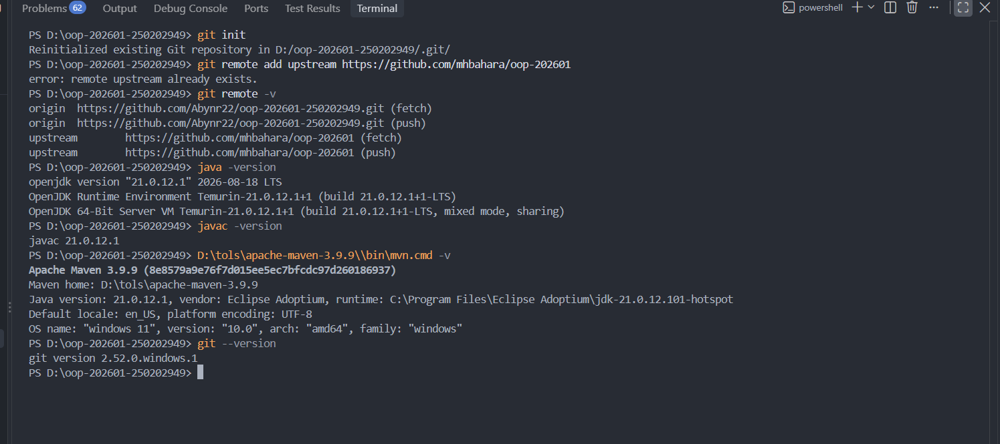
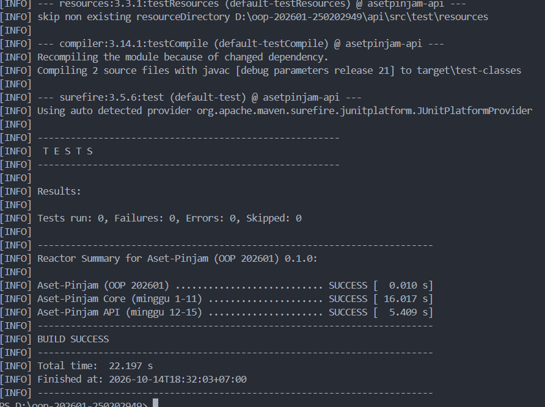

# Minggu 01 : Paradigma Pemrograman dan Setup

## Yang Saya Kerjakan Pada Minggu Ini
Saya menginstal maven, JDK 21, serta git. Mem-fork dan Mengklon Repositori oop-202601 yang di berikan dosen. Pada langkah pertama saya mengisi nim, dan nama di mahasiswa.properties. Kemudian menyelesaikan codingan tiga kelas sapaan (HelloProsedural, HelloOOP, HelloFungsional). Di bagian ini harus mengisi semua teks yang sama persis, tidak boleh berbeda, dan menggunakan 3 gaya berbeda. Test selesai dengan semua codingan dan diisi dengan benar. Test Minggu01Test berhasil (0 gagal).

## Keputusan desain
Saya menggunakan kalimat : "Hello Aset-Pinjam, Nama saya " + nama + ", Nim (" + nim + ")" agar ketiga gaya pemanggilan fungsi dapat di bandingkan.

## Kendala Yang Saya Hadapi Saat Mengerjakan
1. Saya salah input teks yang sama pada masing-masing codingan akibatnya pada (Minggu01Test.java) ada sedikit gagal, dan saya mencari kesalahan itu cukup lama.
2. Pada saat instal maven, terminal saya tidak bisa menjalankan/membaca lokasi file tersebut alhasil ".\scripts\uji.ps1" tidak dapat di jalankan.
3. Baru mengenal bahasa pemrograman Java yang menyebabkan saya sedikit kendala pada saat ngoding.

## Penggunaan AI
Saya menggunakan Ai pada bagian: untuk membantu bagian memahami pengerjaan minggu ini, Penginstalan dan inisialisasi tools, code yang di butuhkan untuk inisialisali, dan sedikit penjelasan codingan pada pekerjaan utama.

Promt utama : Bagaimana cara saya mengerjakan tugas minggu ini jelaskan dengan bahasa yang saya pahami.

## Dokumentasi

